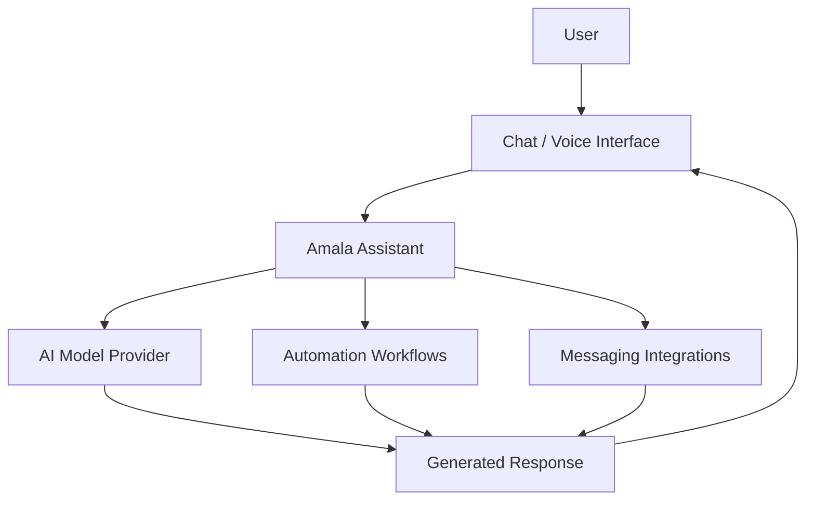

<!--
  AMALA AI — GitHub Profile README
  Theme: Burgundy / Black / Neon Red
  Before publishing:
  1. Replace YOUR_AMALA_GITHUB_USERNAME with the verified username.
  2. Add assets/header.svg, assets/quote.svg, assets/footer.svg.
  3. Verify every project URL and enabled feature.
-->

 

<h1>🔴 AMALA AI</h1>

### Your Personal AI Assistant

  

  <em>Intelligence that assists. Automation that delivers.</em>

  
  
  

---

## ◈ About Amala

Amala is a personal AI assistant project designed to make everyday digital tasks easier through conversational AI, intelligent assistance, and automation.

The vision is simple: build an assistant that can understand requests, help organize work, and connect useful AI capabilities with practical workflows.

**The goal is not just to chat. It's to help get things done.**

### ✦ Core vision

- 🧠 **AI Assistance** — Conversational intelligence through supported AI model integrations.
- 💬 **Natural Interaction** — An approachable assistant designed for practical everyday conversations.
- 🌐 **Tamil + English** — A multilingual interaction experience where supported by the configured models and voice pipeline.
- ⚙️ **Automation** — Connect assistant capabilities to useful tasks and workflows.
- 📱 **Messaging Integration** — Explore messaging-based interactions through configured channels.
- 🎙️ **Voice Interaction** — Build a more natural assistant experience through supported voice integrations.
- 🔐 **Privacy Awareness** — Keep credentials private and handle sensitive information responsibly.

> Note: These describe the project's direction and known areas of development. Actual availability depends on the current implementation and configured integrations.

---

## ◈ What Makes Amala Different?

<table>
<tr>
<td width="50%" valign="top">

### 🧠 Intelligent Assistance

A personal assistant experience designed around useful conversations, practical tasks, and configurable AI models.

</td>
<td width="50%" valign="top">

### ⚡ Automation First

A foundation for connecting AI assistance to repeatable workflows instead of limiting the experience to chat.

</td>
</tr>
<tr>
<td width="50%" valign="top">

### 🌏 Natural Communication

Aiming for comfortable Tamil and English interactions, subject to the capabilities of the selected models.

</td>
<td width="50%" valign="top">

### 🔒 Responsible by Design

Protect API keys, restrict access to integrations, and avoid exposing private credentials in source code or public documentation.

</td>
</tr>
</table>

---

## ◈ Project Architecture

The following illustrates the intended high-level architecture. It is a conceptual overview, not a claim that every component is already implemented.

### Architecture principles

- Modular integrations.
- Configurable AI providers.
- Clear separation between model inference and task execution.
- Explicit permission checks for sensitive actions.
- Secure credential management.
- Reliable error handling and fallback behavior.

---

## ◈ Featured Projects

These are related projects worth exploring. Verify repository ownership, current URLs, and project status before publishing.

<table>
<tr>
<td width="50%" valign="top">

### 🤖 Multimax AI Growth Studio

An AI-focused growth and productivity project built with a modern web stack.

**Repository**

[View source code](https://github.com/Raj-max-pixal/multimax-ai-growth-studio)

</td>
<td width="50%" valign="top">

### 🎙️ JanVoice AI

An AI voice-assistant project with a React and Vite frontend and Firebase integration.

**Repository**

[View source code](https://github.com/Raj-max-pixal/janvoice-ai)

</td>
</tr>
<tr>
<td width="50%" valign="top">

### 📚 StudyBuddy AI

An AI-assisted learning project created for a Qwen Cloud hackathon.

**Repository**

[View source code](https://github.com/Raj-max-pixal/studybuddy-ai-qwen)

</td>
<td width="50%" valign="top">

### 🔴 Amala AI

The primary personal AI assistant project.

**Repository**

Add Amala's verified repository URL here.

</td>
</tr>
</table>

---

## ◈ Technology Stack

The following badges represent technologies associated with the broader development ecosystem. Confirm which ones are actually used in Amala's current repository before treating this list as its implemented stack.

### AI & Model Providers

### Development & Integrations

---

## ◈ GitHub Analytics

<!-- Replace YOUR_AMALA_GITHUB_USERNAME with the verified account username. -->

  

  

---

## ◈ Contribution Journey

<!-- Configure a GitHub Actions workflow to generate this file before enabling it. -->

The contribution animation requires a separately configured GitHub Actions workflow. It will not work merely by adding this image URL.

---

## ◈ Project Principles

- **Useful AI:** Prioritize practical assistance over unnecessary complexity.
- **Modular development:** Keep integrations maintainable and replaceable.
- **Privacy first:** Never commit secrets, access tokens, private phone numbers, or credentials.
- **Transparent capabilities:** Clearly distinguish working features from experiments and planned improvements.
- **Open development:** Document meaningful changes and keep project instructions understandable.

---

## ◈ The Amala Philosophy

> "Technology becomes powerful when it makes life simpler."

---

## ◈ Connect & Explore

  

  <em>Built around a simple idea: make intelligent assistance more useful, accessible, and practical.</em>

